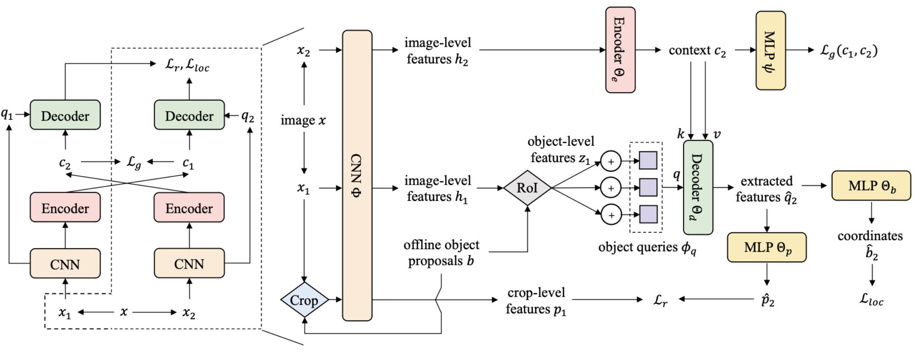

# Siamese DETR

Por Zeren Chen, Gengshi Huang, Wei Li, Jianing Teng, Kun Wang, Jing Shao, Chen Change Loy, Lu Sheng.

Este repositorio es una implementación oficial del artículo [Siamese DETR](https://arxiv.org/abs/2303.18144).

## Introducción

Proponemos Siamese DETR, un nuevo método de preentrenamiento no supervisado para DETR. Con dos nuevas tareas de pretexto diseñadas, localizamos directamente las regiones de consulta generadas por Edgeboxes de manera transversal entre vistas y maximizamos la consistencia semántica entre vistas, aprendiendo transferencia de representaciones de localización y discriminación a tareas de detección posteriores.

<div align="center"></div>

## Preliminares

#### 1. Requisitos del entorno

Este código se implementa basándose en la base de código [MMSelfSup](https://github.com/open-mmlab/mmselfsup). Probamos el código con Python 3.6, PyTorch 1.8.1, CUDA 9.0 y CUDNN 7.6.5. Otros requisitos pueden instalarse mediante:

```bash
pip install -r requirements/runtime.txt --user
```

#### 2. Atención deformable

Compile el *wheel* siguiendo el repositorio de Deformable DETR [aquí](https://github.com/fundamentalvision/Deformable-DETR).

#### 3. EdgeBoxes offline

Puedes generar EdgeBoxes offline mediante:

```bash
cd tools/hycplayers
pip install -r requirements.txt --user

sh run.sh <TU_PARTICIÓN> <NUM_PROCESOS> <RUTA/A/DATOS/RAÍZ> <RUTA/A/DATOS/META> <RUTA/A/GUARDAR> <CONJUNTO_DE_DATOS>  # <CONJUNTO_DE_DATOS> debe ser imagenet o coco 
```

#### 4. Retina backbone preentrenada con SwAV

Siamese DETR utiliza un backbone SwAV congelado para extraer características. Puedes descargar el backbone preentrenado con SwAV (800 ep@75.3 top1) desde el repositorio de SwAV [aquí](https://github.com/facebookresearch/swav).

#### 5. Crear enlace simbólico

Proporcionamos archivos de metadatos estilo COCO para los archivos PASCAL VOC (ver `data/datasets/voc_meta`) para el ajuste fino posterior.

Colócalos en el directorio `voc`.

```bash
mkdir -p data/datasets/edgebox

ln -s path/to/swav/backbone data/model_zoo/resnet/swav_800ep_pretrain_oss.pth.tar

# dataset
ln -s path/to/coco2017 data/datasets/mscoco2017
ln -s path/to/imagenet data/datasets/imagenet
ln -s path/to/voc data/datasets/voc
cp -rf data/datasets/voc_meta data/datasets/voc/meta

# edgebox
ln -s path/to/imagenet/edgebox data/datasets/edgebox/imagenet
ln -s path/to/coco/edgebox data/datasets/edgebox/coco
```

#### 6. Preparación para ajuste fino posterior

Proporcionamos un ejemplo para ajuste fino posterior, es decir, Conditional DETR en `downstream_finetune/conditionaldetr`.

Las principales modificaciones comparadas con el repositorio original incluyen:

* Agregar argumentos `--pretrain` para cargar el punto de control preentrenado de Siamese DETR. (Ver [main.py](downstream_finetune/conditionaldetr/main.py) L160-168)

* Agregar conjuntos de datos PASCAL VOC. (Ver [voc.py](downstream_finetune/conditionaldetr/datasets/voc.py)) 

## Uso

```bash
# preentrenamiento en arriba en ImageNet/COCO
# Puedes revisar work_dirs/selfsup/siamese_detr/<cfgs>/<tiempo>.log.json para detalles del entrenamiento.
sh tools/srun_train.sh <PARTICIÓN> <CONFIG> <NUM_GPUS> <NOMBRE_JOB>  

# convertir punto de control OSS a punto de control DETR
python tools/convert_to_detr.py --ckpt <CKPT_OSS> --export <RUTA/GUARDAR> [--deform]

# ajuste fino posterior
cd downstream_finetune/<DE_TR variants_dir>
sh [train_coco.sh|train_voc.sh] <PARTICIÓN> <CKPT_CONVERTIDO> <NUM_GPUS> <NOMBRE_JOB>
```

## Model Zoo

Proporcionamos puntos de control preentrenados [aquí](https://github.com/Zx55/SiameseDETR/releases/tag/v0.1).

**Resultados de transferencia en ImgNet → COCO** (Reportamos AP en la prueba posterior)

<table>
  <thead>
    <th>Método</th>
    <th>Vanilla</th>
    <th>ConditionDETR-100q</th>
    <th>DeformableDETR-MS-300q</th>
  </thead>
  <tbody>
    <tr>
      <td>desde cero</td>
      <td>39.7</td>
      <td>37.7</td>
      <td>45.5</td>
    </tr>
    <tr>
      <td>UP-DETR</td>
      <td>40.5</td>
      <td>39.4</td>
      <td>45.3</td>
    </tr>
    <tr>
      <td>DETReg</td>
      <td>41.9</td>
      <td>40.2</td>
      <td>45.5</td>
    </tr>
    <tr>
      <td>SiameseDETR</td>
      <td>42.0</td>
      <td>40.5</td>
      <td>46.4</td>
    </tr>
  </tbody>
</table>

**Resultados de transferencia en ImgNet → PASCAL VOC**

<table>
  <thead>
    <th>Método</th>
    <th>Vanilla</th>
    <th>ConditionDETR-100q</th>
    <th>DeformableDETR-MS-300q</th>
  </thead>
  <tbody>
    <tr>
      <td>desde cero</td>
      <td>47.8</td>
      <td>49.9</td>
      <td>56.1</td>
    </tr>
    <tr>
      <td>UP-DETR</td>
      <td>54.4</td>
      <td>56.9</td>
      <td>56.4</td>
    </tr>
    <tr>
      <td>DETReg</td>
      <td>57.0</td>
      <td>57.5</td>
      <td>59.7</td>
    </tr>
    <tr>
      <td>SiameseDETR</td>
      <td>57.4</td>
      <td>58.1</td>
      <td>61.2</td>
    </tr>
  </tbody>
</table>

**Resultados de transferencia en COCO → PASCAL VOC**

|Método|ConditionDETR-100q|
|:----:|:----:|
|desde cero|49.9|
|UP-DETR|51.3|
|DETReg|55.9|
|SiameseDETR|**57.7**|

## Licencia

Siamese DETR se publica bajo la licencia Apache 2.0. Por favor, consulta el archivo LICENSE para más información.

## Cita

```
@article{chen2023siame,
  title={Siamese DETR},
  author={Chen, Zeren and Huang, Gengshi and Li, Wei and Teng, Jianing and Wang, Kun and Shao, Jing and Loy, Chen Change and Sheng, Lu},
  journal={arXiv preprint arXiv:2303.18144},
  year={2023}
}
```
